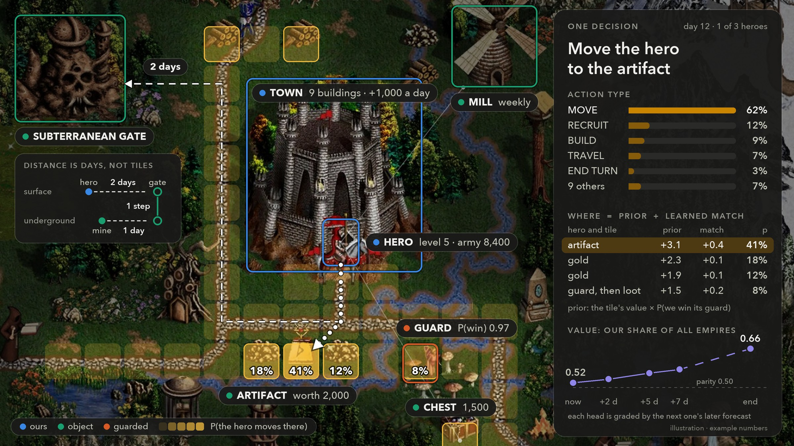
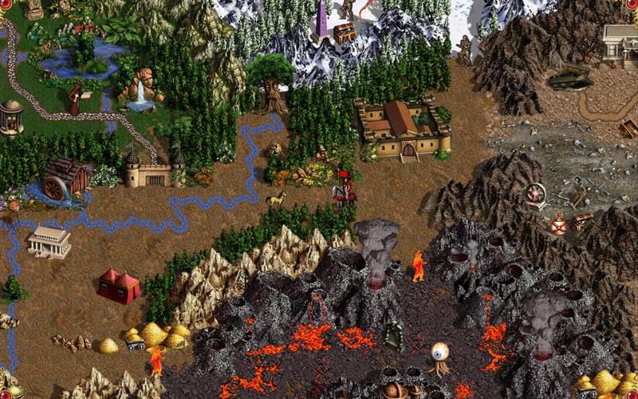
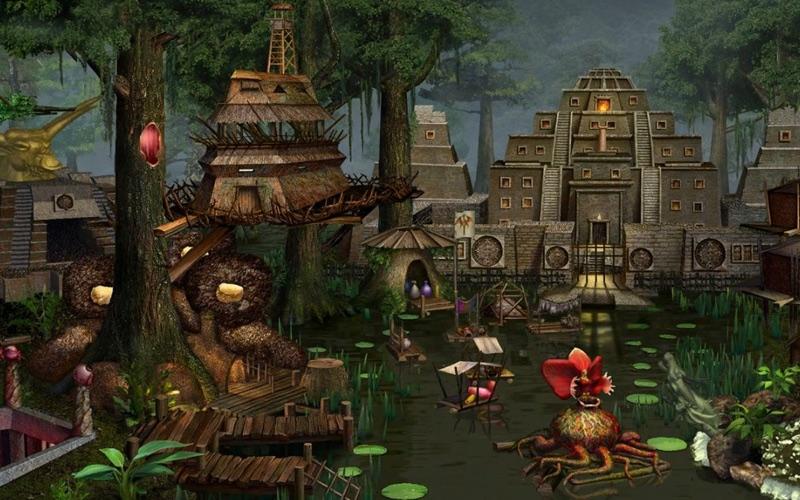
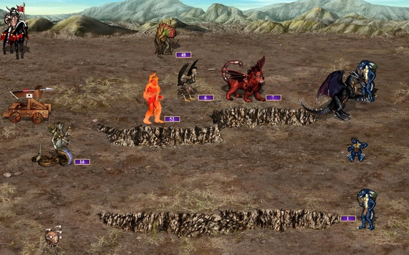
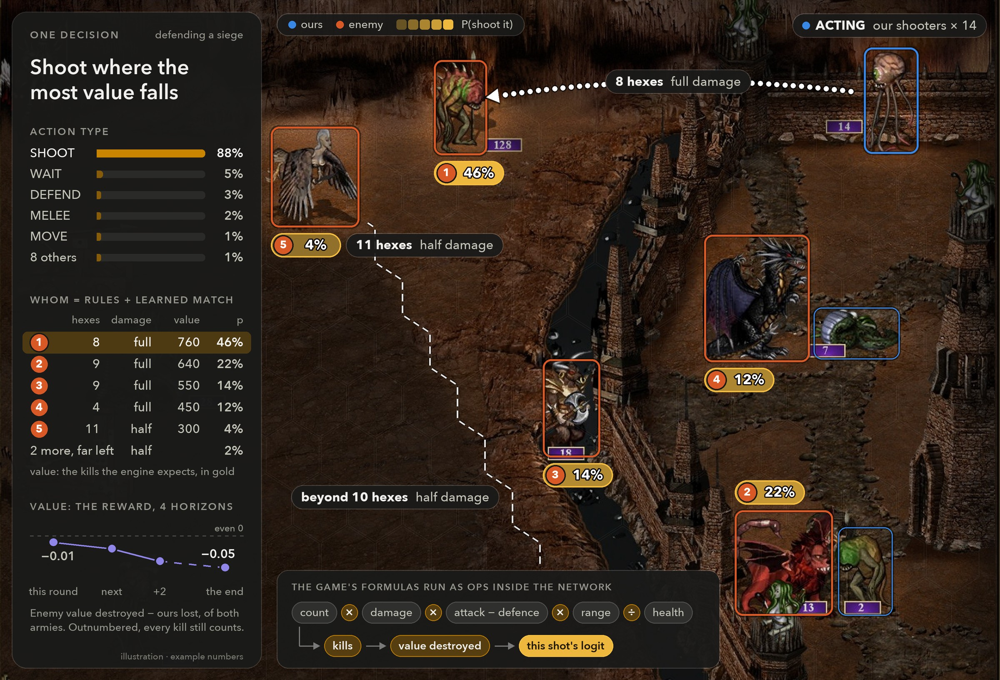
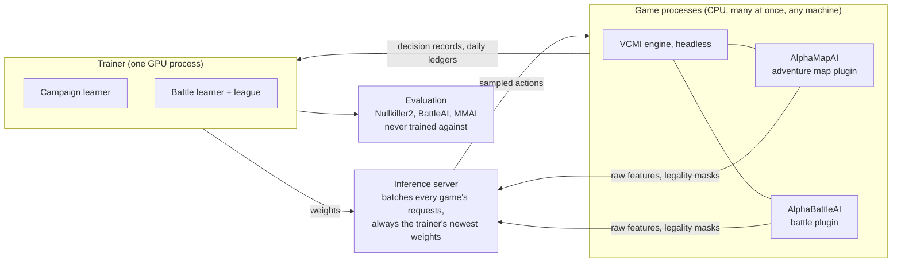
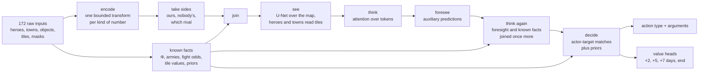

<div align="center">

# Alpha Heroes

**A learning agent for the full game of Heroes of Might and Magic III,<br/>trained by self-play on one consumer GPU.**



<sub>One decision, as the agent sees it. The map's entities become tokens that carry what the game already knows (a price, the odds of a fight).<br/>
The hero's move is one softmax over every tile it can reach, each scored as a prior plus a learned match. Value heads forecast our share of all empires at four horizons.<br/>
Distance is counted in days of movement along the engine's own paths, not in tiles: the Subterranean Gate is two days away, and one step beyond it lies another level.<br/>
An illustration with example numbers, drawn over a screen from Heroes of Might & Magic III HD Edition (Ubisoft).</sub>

Two neural networks play the whole game inside the open-source [VCMI](https://github.com/vcmi/vcmi) engine:<br/>
one makes every adventure-map decision, the other fights every battle. They train together, in one run.


[Why Heroes III](#why-heroes-iii) · [Results](#results) · [How it works](#how-it-works) · [Quick start](#quick-start) ·
[Training](#training) · [Evaluation](#evaluation) · [Repository map](#repository-map) · [Docs](#documentation)

</div>

---

## Why Heroes III

> A game built for people, not machines: dozens of kinds of decisions, and every one of them matters.

Go fell in 2016, StarCraft II and Dota 2 in 2019, each to a system with a data-centre budget. Heroes of Might and
Magic III, a 1999 turn-based strategy game that people still play today, has as far as we know no learned agent that
plays the full game. It looks like the easy case, because it is turn-based. It is not.

### One game, three layers

Up to eight players take turns, one day each, until one has eliminated the rest.

<table>
<tr>
<td width="33%"></td>
<td width="33%"></td>
<td width="33%"></td>
</tr>
<tr>
<td valign="top"><b>Heroes walk the map.</b> Each hero has movement points a day: flag mines, collect resources and artifacts, visit about 230 kinds of objects, fight the monsters that guard them.</td>
<td valign="top"><b>Towns build armies.</b> One building a day per town. Creatures grow every week and must be bought; spells come from the mage guild, trades from the market.</td>
<td valign="top"><b>Every clash is a battle.</b> A hex field, up to 7 creature stacks a side, turn order by speed, one hero spell a round. Lose, and the hero may be gone.</td>
</tr>
</table>

<sub>Screens: Heroes of Might & Magic III HD Edition (Ubisoft). We train on VCMI, an open-source re-implementation of the 1999 engine.</sub>

### Harder than it looks

On every row but the first, Heroes III matches StarCraft II or Dota 2, or goes past them.

| | Go | StarCraft II | Dota 2 | **Heroes III** |
|---|---|---|---|---|
| Pace | Turn-based | Real time | Real time | **Turn-based** |
| Information | Perfect | Fog of war | Fog of war | **Fog of war** |
| Players | 2 | 2 | 2 teams of 5 | **2 to 8, each for itself** |
| State | 19 x 19 board | up to 512 units | about 16,000 values | **Unbounded: stacks and gold up to 2³¹, split or traded any way** |
| Decisions a game | about 150 | thousands | about 20,000 steps | **about 2,000 on a small map, plus every battle's** |
| Chance | No | Yes | Yes | **Yes** |
| Sub-games | No | No | No | **Yes: every fight is a tactical battle of its own** |
| Human data | 160K games | 971K replays | none used | **None at scale** |
| Compute of the landmark system | AlphaGo: 50 GPUs to train, 176 to play | AlphaStar: 12 agents x 32 TPUs, 44 days | OpenAI Five: 45,000 years of self-play; at peak 1,536 optimizer GPUs and 172,800 CPU cores | **This project: one RTX 5090 and a laptop** |

### Six problems the game poses

1. **Many kinds of decisions, all of them meaningful.** The game keeps asking questions. Which of two skills at a
   level-up? Gold or experience from a chest? Chase the monsters that flee, or accept the ones that offer to join?
   Fight a creature bank's guards? Open Pandora's box? OpenAI Five scripted its item and skill builds. Here those
   choices are the game, so a script would cap the agent at the script.
2. **Complex objects, unbounded numbers.** A hero is a small database: a level, 4 primary skills, up to 8 of 28
   secondary skills, up to 70 spells, 19 artifact slots, an army of 7 stacks. A stack is 1 Black Dragon or 4,000
   Skeletons. Taking the log of a count blurs the few creatures that decide a fight, so the game's own damage formula
   runs inside the network as an op: the model reasons with what a stack does to another, not with how big it is.
3. **The map is a graph, not a grid.** Two levels joined by gates, monoliths that teleport, water that needs a boat,
   roads at half the cost of grass and swamps at nearly twice, spells that change the geometry. "Near" means
   "reachable today". The engine's pathfinder gives each hero its reachable tiles and their cost in days, and the
   network reads those instead of guessing.
4. **A battle inside every fight.** A 15 x 11 hex field, about 140 kinds of creatures each with its own rules,
   morale and luck as dice, and sieges with walls, a moat and arrow towers. Tens to hundreds of decisions, inside
   one map decision.
5. **Two models, and what falls between them.** A battle model that sees only this battle cannot know that mana
   should be saved for tomorrow, or which creatures can be replaced this week. One currency joins the two: the
   battle is paid the change in Φ, the campaign's gold value of everything a player owns.
6. **Every reward leads to the same endgame.** Maximise gold, armies or paperclips: given enough days, the best
   plan is always to eliminate every rival and take the map. The real problem is which reward teaches sane decisions
   on day 3, from few games.

The rules of the project are strict on purpose. The agent plugs into VCMI as an ordinary AI and sees only what a
human player sees. Training is self-play only: the scripted AIs it is measured against are never training opponents.
Everything that decides behaviour lives in the PyTorch graph.

The longer story, from AlphaGo to this project, is a 62-slide talk:
[From AlphaGo to Heroes III](docs/From_AlphaGo_to_Heroes_III.pptx).

## At a glance

| | |
|---|---|
| **Battle model** | 430k weights. Attention over unit, hero, hex and battle tokens; the engine's own rules (damage, reach, retaliation, spell effects) as exact tensor ops; conditional action heads with an exact log-probability and entropy; PPO against a league of its own past versions. |
| **Campaign model** | 3.4M weights. Typed encoders for 172 raw input tensors, a U-Net over the whole map, attention over heroes, towns and players, a small memory, auxiliary foresight heads; every logit is an actor-target match plus a prior. |
| **Reward** | Φ, the gold value of everything a player owns. Buying at list price leaves Φ unchanged, so value only appears through production, pick-ups, fights and captures. The target is the change in our share of all players' Φ. |
| **Engine side** | VCMI 1.7.5 plus 45 commits of our own (bug fixes, determinism, headless play, each labelled) and 14k lines of C++ plugins that serialize raw features and legality masks against a versioned, hashed tensor contract generated from Python. |
| **Training system** | One trainer process on the GPU for both models, games played on demand by `DataLoader` workers, a batching inference server, CUDA-graph captured update steps, deploys that drain and restart the live run without losing a game. |
| **Code** | 43k lines of Python (645 tests), 482 commits in the first 22 days. |

## Results

Dated 2026-11-12, three weeks after the first commit. All numbers come from fixed evaluation sets that are never
trained on.

### Battles: ahead of both reference AIs

The battle model (430k weights) outscores VCMI's own battle AI and MMAI, an outside learned battle AI that ships with
the engine. It is ahead on every evaluation set, by more than two standard errors on four of the five.

Each of 268 fixed battles is played greedily from both seats against each opponent, 1,072 battles in all. The score
is the battle reward on a -1..1 scale **minus what the reference AI itself earns in the same seat against itself**,
so 0 means "as good as the reference", whatever the seat is worth.

| Evaluation set | vs BattleAI | vs MMAI |
|---|---|---|
| Generated armies, heroes, spells, sieges (72) | +0.163 ± 0.020 | +0.124 ± 0.022 |
| Hard cases (72) | +0.086 ± 0.018 | +0.072 ± 0.019 |
| Castle against Inferno, 48 seeds | +0.126 ± 0.021 | +0.161 ± 0.019 |
| Battles taken from real games (40) | +0.038 ± 0.014 | +0.038 ± 0.014 |
| Wandering monsters (36) | +0.022 ± 0.011 | +0.014 ± 0.014 |
| **All battles** | **+0.098** | **+0.089** |

<p align="center"><br/>
<sub>One battle decision, as the model sees it. Our shooters, defending a siege, choose among the enemy stacks; each carries the chance the policy gives a shot at it.<br/>
The game's damage rules run as ops inside the network: past the dashed line, ten hexes from the shooter, a shot does half damage, and what a shot is expected to destroy is added to its logit beside a learned match.<br/>
Four value heads forecast the battle's reward: at the end of this round, of the next two, and of the battle.<br/>
An illustration with example numbers, drawn over a screen from Heroes of Might & Magic III HD Edition (Ubisoft).</sub></p>

- The margin holds in both seats. Defending, it destroys 57% of the attacking army where BattleAI in the same seat
  destroys 48%.
- It is stable: between +0.09 and +0.10 over more than 50 evaluations since Oct 30.
- It is also flat. The model has not improved since Oct 30, and it is not optimal: its shooters still waste 1 to 3%
  of their full-damage shots. Why, and the plan: [docs/battle_model_plan.md](docs/battle_model_plan.md).

### The full game: closing on the scripted AI

The campaign model plays full games against Nullkiller2, VCMI's strongest scripted AI: 2 to 4 players on 36 x 36
random maps, 56 days, 48 fixed setups. The score is our share of all empires' value at the end, times the number of
players: 1.0 is parity with the average player at the table, 0 is elimination.

| When | Score | What changed |
|---|---|---|
| Oct 31 | 0.11 | Start of the main run, from imitation alone |
| Nov 1 | 0.22 | Teacher labels repaired (they taught one-tile moves) |
| Nov 3 to 4 | 0.40 to 0.51 | A new Φ, loss shares, fixes for suicidal attacks |
| Nov 10 to 11 | 0.50 to 0.58 | Meeting fixes, a run-away prior, moves past gates |
| Nov 12 | 0.76 | Teacher removed, its planner's candidates kept as inputs (mean of four 48-game replicates) |
| Nov 12, paired test of the change deployed that day | 0.90 | A build-economy prior and bounded economy features: +0.143 ± 0.054 on the same games, eliminations from 25% to 6% (two replicates) |

The last two rows are paired-test replicates on the second machine (same setups, battles fought by BattleAI). The
training machine's own evaluations of the Nov 12 checkpoint read 0.84 and 0.77 before the change (8 and 11 of 48
games lost by elimination) and 0.80 with it (6 of 48): one such evaluation moves by about ±0.1, so there the gain
shows in the eliminations before it shows in the score.

**What these numbers do not show yet**

- The campaign model is below parity with Nullkiller2, and it still reads that AI's planner candidates as input features.
  An auxiliary head learns to predict them so the planner can leave serving later.
- No from-scratch rerun and few clean ablations: the main run carried many changes live, often several at once.
- One 48-game evaluation moves by about ±0.1 from run to run. Every claim above rests on replicates or paired tests.
- No games against humans yet (three are recorded as a test set), and large maps are untested.

## How it works



### Design decisions that carry the project

- **Python owns the science.** The C++ plugins pass raw engine values and legality masks, and execute the chosen
  action. They decide nothing. The contract (every tensor's name, dtype, shape and meaning) is written once in Python
  (`schema.py`, `constants.py`), hashed, and generated into a C++ header; a plugin refuses a model whose contract
  differs.
- **The game's rules inside the graph.** Damage, kill chances, reach, retaliation and spell effects are computed
  exactly as the engine computes them, as tensor ops on the raw inputs. Each such number lands on the logit of the
  action it describes, with a weight that starts at zero or at a sane prior and is learned from there.
- **Priors with bounded, learnable corrections.** Where the game has a known value (a price, a fight's odds, a
  building's income), the model starts from it. Learned parts start at zero output, so a new feature can never break
  a working policy on the day it ships.
- **A value-neutral reward.** Φ prices everything at list price, so a purchase is neither rewarded nor punished by
  itself. The labels are the change in logit(our Φ / everyone's Φ) at 2, 5 and 7 days, plus the end of the game with
  the game's length drawn at random so the last day cannot be gamed. Details: [docs/empire_value.md](docs/empire_value.md).
- **Telescoped value heads and a privileged critic.** V7 is graded by V5 two days later, V5 by V2, V2 by reality.
  During training only, the critic also reads the rivals' hidden state.
- **Credit that respects the noise.** Battles use a linear window over rounds instead of GAE. On the map, the
  2-day surprise counts in full and later days are weighted by their measured signal.
- **No masking to fix behaviour.** Masks encode legality only. An overused action is a learning problem and is
  fixed as one.

### The campaign model's forward pass



Any map size runs through a fixed 36 x 36 block grid (small maps are bit-identical to the plain model). The action
space has macros (recruit all, gather, take the best army), per-slot army moves, artifact swaps, market trades and
one softmax over every (hero, tile) pair inside a movement window. Design notes:
[docs/campaign_model_v2_draft.md](docs/campaign_model_v2_draft.md), [docs/campaign_ai.md](docs/campaign_ai.md).

### The training system

- **Games follow the learner's demand.** The games are the dataset: `DataLoader` workers start a game only when the
  learner will take it, on this machine first and on remote slots once its cores are full (`battle_model/supply.py`).
- **One trainer, two models.** Both learners share one GPU process and take turns. Campaign battles are 60% of each
  battle update; generated battles and past versions fill the rest so the battle model does not forget.
- **Captured update steps.** Under WSL every CUDA kernel launch is expensive, so the campaign update is recorded as
  CUDA graphs and replayed: a whole update is about 3.5x faster, with gradients matching eager mode to 5e-4. A test
  guards the forward pass against ops that break capture.
- **Deploys without loss.** A live change drains the playing games, runs gates on a copy of the live checkpoint
  (bit-identical outputs with the change switched off, a recorded and replayed update step, timing within 5%),
  restarts the run, and restores the old line by itself if a gate fails.
- **Guards.** A value-loss guard stops training on the signature of a policy collapse; a memory guard stops the run
  before the kernel's OOM killer would, and a keeper restarts it.

## Quick start

Tested on macOS (Apple Silicon) and Ubuntu 26.04 under WSL2 with an NVIDIA GPU.

**You need** the game data: the GOG offline installer of *Heroes of Might and Magic III Complete*. It is copyrighted
and not in the repository. The code and its VCMI fork (a submodule) are public.

**1. Clone and build the engine with the plugins**

```sh
git clone --recurse-submodules https://github.com/ARozental/alpha_heroes.git
cd alpha_heroes

# macOS
brew install cmake ninja ccache innoextract boost minizip sdl2 sdl2_image sdl2_mixer \
  sdl2_ttf tbb libsquish onnxruntime fmt glaze ffmpeg qt

cmake -S vcmi -B build -G Ninja -D CMAKE_BUILD_TYPE=RelWithDebInfo -D ENABLE_TEST=OFF \
  -D CMAKE_C_COMPILER_LAUNCHER=ccache -D CMAKE_CXX_COMPILER_LAUNCHER=ccache \
  -D EXTRA_AI_DIRS="$(pwd)/agents/UpLeftAI;$(pwd)/agents/AlphaBattleAI;$(pwd)/agents/AlphaMapAI"
cmake --build build
```

<details>
<summary>Linux</summary>

Install VCMI's build packages ([vcmi/docs/developers/Building_Linux.md](vcmi/docs/developers/Building_Linux.md)) and
`innoextract`, unpack the ONNX Runtime 1.31.0 release for Linux x64, and point CMake at it:

```sh
ORT=$HOME/tools/onnxruntime-linux-x64-1.31.0
cmake -S vcmi -B build -G Ninja -D CMAKE_BUILD_TYPE=RelWithDebInfo -D ENABLE_TEST=OFF \
  -D CMAKE_PREFIX_PATH=$ORT -D CMAKE_BUILD_RPATH=$ORT/lib \
  -D EXTRA_AI_DIRS="$(pwd)/agents/UpLeftAI;$(pwd)/agents/AlphaBattleAI;$(pwd)/agents/AlphaMapAI"
cmake --build build
```

</details>

**2. Python**

```sh
python3 -m venv .venv
.venv/bin/pip install -r battle_model/requirements.txt     # torch 2.14 (CUDA on Linux, MPS on a Mac), onnx, tensorboard, pytest
```

**3. Game data**

```sh
mkdir -p runtime/vcmi-user
innoextract -s -g -d runtime/gog-extract <path>/setup_heroes_of_might_and_magic_3_complete_*.exe
mv runtime/gog-extract/{Data,Maps,Mp3} runtime/vcmi-user/ && rm -rf runtime/gog-extract
```

Everything the game writes (settings, saves, logs, training runs) stays under `runtime/`, which git ignores.

**4. The engine's tables and a first model file**

```sh
scripts/export_vocab.sh                    # the engine's tables (creatures, spells, heroes, buildings) into battle_model/artifacts/vocab.json
.venv/bin/python -m battle_model.export    # an untrained battle model as ONNX, checked against the contract
```

The first command also starts the engine once on your data, which writes VCMI's own settings to
`runtime/vcmi-user/config/` (training reads the list of active mods from there).

**5. Check the installation**

```sh
.venv/bin/python -m pytest battle_model/tests campaign_model/tests -q
scripts/headless.sh "Maps/Elbow Room" 120 100     # one AI-only game without a window: map, max seconds, max MB
```

`scripts/headless.sh` is the only way games are run without a window: each gets its own directory under
`runtime/runs/` and is killed on a time limit, a disk limit or a stalled log.

## Training

Each run writes to `runtime/train/<start time>-<name>/` (checkpoints, `progress.csv`, TensorBoard). Any config field
can be set with `--set name=value`; `--run NAME --resume` continues the newest run of that name.

```sh
.venv/bin/tensorboard --logdir runtime/train       # http://localhost:6006
```

Evaluations play BattleAI and MMAI. The commands below pass `eval_extra_opponents=` (BattleAI only), so they work on
a new checkout; drop that setting once the MMAI mod is installed (see [Evaluation](#evaluation)).

### 1. The battle model

```sh
# A first run in minutes: one fixed battle (Castle against Inferno), our model on both sides
.venv/bin/python -m battle_model.train --run first --epochs 20 --set opponent=self eval_extra_opponents=

# The real recipe: a new random battle every game (armies, heroes, spells, sieges, wandering monsters),
# a league of the current model and its past versions, greedy evaluations every hour on fixed battle sets
.venv/bin/python -m battle_model.train --run battle \
    --set generator=true actors=true learning_rate=1e-5 run_hours=24 eval_minutes=60 eval_extra_opponents=
```

- On the RTX 5090 add `--machine configs/machines/rtx5090/battle-gpu-free.toml` (how many games and servers the
  machine carries; never what is learned). Sizes for a new machine: [configs/machines/README.md](configs/machines/README.md).
- With `run_hours` the learning rate falls linearly over the run. The project's rule is a rate of at most 3e-5,
  1e-5 recommended: higher rates learned faster and then forgot.
- The log prints the warning signs of forgetting every update (Adam signal ratio, weight change, KL, clip fraction).

### 2. The campaign model, together with the battle model

`campaign_model.joint` trains both in one run: self-play campaign games on random maps, every battle in them fought by
the battle model, which keeps learning from those battles. It starts the battle model from a checkpoint.

```sh
# A smoke test on a laptop: two campaign games at a time, six minutes, both models updating
.venv/bin/python -m campaign_model.joint --run smoke --hours 0.1 \
    --battle-from runtime/train/<battle run>/checkpoint_latest.pt \
    --machine configs/machines/mac-m4/joint-smoke.toml --set eval_extra_opponents=

# A real run on a CUDA machine (sizes measured on an RTX 5090 with 28 GB for WSL)
.venv/bin/python -m campaign_model.joint --run joint --hours 12 \
    --battle-from runtime/train/<battle run>/checkpoint_latest.pt \
    --machine configs/machines/rtx5090/joint-gpu-free.toml --set eval_extra_opponents=

# Stop with Ctrl-C or kill -TERM; go on later
.venv/bin/python -m campaign_model.joint --run joint --hours 12 --resume
```

Useful campaign settings (`campaign_model/config.py` documents every field with the measurement behind it):
`campaign.games` (games at once), `campaign.init_from` (start from a campaign checkpoint), `campaign.eval_minutes`,
`campaign.eval_games`.

<details>
<summary><b>Reproducing the project's main run (joint7)</b></summary>

Weights are not in git. The main run did not start from scratch:

1. **Imitation.** The campaign model first learned to choose Nullkiller2's decisions on that AI's own games
   (`campaign_model/imitate.py`, streamed, truncated backpropagation through the model's memory).
   `runtime/full_run.sh` is that pipeline.
2. **Self-play RL from there.** `runtime/advice_run.sh` is the live run's exact command line. Its header gives the
   reason and the measurement behind every setting.
3. **Or copy the starting points** from a machine that has them:
   ```sh
   rsync -a FIRST:alpha_heroes/runtime/saved/ runtime/saved/
   rsync -a FIRST:alpha_heroes/runtime/train/<run>/campaign/checkpoint_latest.pt runtime/saved/campaign_start.pt
   .venv/bin/python -m campaign_model.joint --run NAME2 --hours 12 --battle-from runtime/saved/<battle checkpoint> \
     --set seed=2 campaign.seed=2 campaign.init_from=runtime/saved/campaign_start.pt
   ```

</details>

<details>
<summary><b>One run on several machines</b></summary>

The machine with the GPU (the master) trains. Other machines (workers) play games for it as its data loader asks. A
worker runs VCMI and, with `--local`, inference servers on its own cores with the master's weights; what it plays
goes back over the slot's connection (`battle_model/remote.py`, `battle_model/worker.py`).

1. Every machine: the same code, the same `vcmi` submodule commit, rebuilt, and the game data. The master refuses a
   worker whose model contracts differ from its own.
2. The master, with `remote_port` set (it listens there, its inference server on `remote_port + 1`, the game slots on
   `remote_port + 100`) and `remote_slots` loader workers kept for remote games:
   ```sh
   .venv/bin/python -m campaign_model.joint --run NAME --hours 12 \
       --machine configs/machines/rtx5090/joint-gpu-free.toml --set remote_port=7700 remote_slots=4
   ```
   The first such run writes the shared secret to `runtime/remote-token`; copy it to each worker's `runtime/`.
3. Each worker, with its own sizes (`configs/machines/<machine>/worker.toml`):
   ```sh
   .venv/bin/python -m battle_model.worker --master <master's address> \
       --machine configs/machines/mac-m4/worker.toml --local
   ```
   It waits for the master and reconnects after a stop and resume of the run.
4. A master inside WSL2: other machines reach WSL only with mirrored networking (`networkingMode=mirrored` under
   `[wsl2]` in `.wslconfig`) or a `netsh interface portproxy` per port, and inbound TCP 7700 to 7760 must pass both
   the Windows firewall and, in mirrored mode, the Hyper-V firewall. Check from a worker: `nc -vz <master> 7700`.
   Use it on a trusted network only: the token is the only lock.

</details>

<details>
<summary><b>A long run as a service that loses nothing at a stop</b></summary>

On Linux the run is a systemd user unit:

```sh
systemd-run --user --unit=alpha-joint7 -p KillSignal=SIGINT -p TimeoutStopSec=900 -p KillMode=mixed \
  -p LimitNOFILE=65536 ~/projects/alpha_heroes/runtime/advice_run.sh        # resumes by itself when its run exists
systemd-run --user --unit=alpha-joint7-keeper ~/projects/alpha_heroes/runtime/keeper.sh alpha-joint7 runtime/advice_run.sh
```

- `runtime/memwatch.sh` samples the run's memory every 10 s and stops the run only when RAM is full and swap nearly
  so; `runtime/keeper.sh` starts it again a minute later (at most 3 times in 6 hours, never after a stop by hand).
- A stop keeps every finished campaign game on disk until the update that trained on it is checkpointed, and saves
  the battles not trained on yet. A resume takes both back. Only games still playing are lost.
- Deploying code to a live run: `DEPLOY="<the copy command>" runtime/drain_restart.sh`. No new game starts, the
  playing ones finish, DEPLOY runs, the run restarts.

</details>

## Evaluation

| What | How |
|---|---|
| **Battle model** | Fixed sets (generated, hard cases, wandering monsters, battles from real games, a regression scenario), played greedily from both sides against BattleAI and MMAI. The score is ours minus the reference AI's own result in the same seat. `eval/battle` in TensorBoard. |
| **Campaign model** | 48 fixed setups against Nullkiller2, 56 days. `eval/campaign` in TensorBoard; eliminations and "dumb decision" counters (pick-ups passed, troops left behind, repeat meetings, idle moves) beside it. |
| **A behaviour change** | A paired test on pinned maps before it reaches the live run: control and change play the same games, two or more replicates each, each arm alone on the machine. |

```sh
.venv/bin/python -m battle_model.evaluate runtime/train/<run>/checkpoint_latest.pt --temperature 0

.venv/bin/python -m campaign_model.paired_eval maps                                    # make and pin the eval maps once
.venv/bin/python -m campaign_model.paired_eval play <control checkpoint> runtime/arms/control
.venv/bin/python -m campaign_model.paired_eval play <new checkpoint> runtime/arms/new
.venv/bin/python -m campaign_model.paired_eval compare runtime/arms/control runtime/arms/new   # paired difference, its standard error, eliminations
```

**MMAI as an evaluation opponent.** MMAI is built with the engine; its models come as the VCMI mod `mmai`. Put the mod
in `runtime/vcmi-user/Mods/mmai/`, list it in `runtime/vcmi-user/config/modSettings.json`
(`"mods": ["vcmi", "core", "mmai"]`) and keep `"seed": 1` in `Mods/mmai/config/mmai-settings.json` so evaluations
replay identically.

**Playing it yourself.** `scripts/make_app.sh` creates `Heroes 3.app` (macOS); `scripts/vcmi.sh` opens the launcher
on any platform. Choose `AlphaBattleAI` under Settings, AI to fight the battle model
(`ALPHA_BATTLE_MODEL` points at the ONNX file; `python -m battle_model.export` writes one).
`campaign_model/record_human.py` records a human's game as an evaluation set.

## Repository map

```
agents/                 C++ plugins, built into VCMI through its EXTRA_AI_DIRS option
  AlphaBattleAI/          battle plugin: encoder, legality masks, inference client, record of each battle
  AlphaMapAI/             adventure-map plugin: encoder, actions, the ledger behind Φ, Nullkiller2's planner as inputs,
                          a recorder for human games, tools (random maps, map info)
  UpLeftAI/               a trivial test AI
battle_model/           the battle model and the shared training machinery
  schema.py constants.py  the tensor contract (codegen.py writes the C++ header)
  rules.py features.py    VCMI's battle rules as tensor ops; bounded, scale-free features built on them
  model.py distributions.py   the network; log-probability and exact entropy of a full conditional action
  reward.py losses.py     what counts as good; how it becomes a training signal
  generator.py scenarios/ random battles and fixed evaluation battles
  train.py actors.py      the training loop, the league, the buffer
  supply.py inference.py  games as a DataLoader; the batching inference server
  remote.py worker.py     several machines in one run
  optim.py aux_value.py   clipping by parameter group, the gradient's signal share, the value's auxiliary phase
campaign_model/         the adventure-map model
  schema.py constants.py  the tensor contract with AlphaMapAI
  encoders.py views.py    typed input encoders; bounded views of every number a learned layer reads
  features.py model.py    the game knowledge: Φ's mirror, fight odds, tile values, danger, the priors
  model_v2.py foresight.py    the network and its auxiliary predictions
  empire.py labels.py     Φ from a ledger; labels from the days after each decision
  train.py learner.py graphs.py   PPO update, the learner in a joint run, CUDA graph capture
  joint.py config.py      the entry point and every setting, with the measurement behind it
  evaluate.py paired_eval.py failures.py   evaluation, paired tests, dumb-decision counters
  imitate.py teacher.py nk_predict.py      imitation of Nullkiller2 and the head that predicts its planner
game_values/            one price list for both models (creatures, heroes, artifacts, war machines)
configs/machines/       per-machine sizes: games, actors, servers. Never what is learned
runtime/*.sh            the live run's command line, the deploy, the memory guard, the keeper
scripts/                the launcher, headless games, the vocabulary export
vcmi/                   submodule: VCMI 1.7.5 plus this project's labelled patches
docs/                   design documents, plans, reviews
```

## Documentation

| Document | What it covers |
|---|---|
| [docs/campaign_ai.md](docs/campaign_ai.md) | The campaign AI: what an empire is worth, what the AI decides, how it trains |
| [docs/empire_value.md](docs/empire_value.md) | Φ, version 3: the value of every asset and map object |
| [docs/campaign_model_v2_draft.md](docs/campaign_model_v2_draft.md) | The campaign network's design, block by block |
| [docs/map_size_plan.md](docs/map_size_plan.md) | One model for every map size: the block grid |
| [docs/training_loop_2026-10-30.md](docs/training_loop_2026-10-30.md) | The training loop rebuilt around a data loader, with the measurements behind each choice |
| [docs/performance_2026-10-29.md](docs/performance_2026-10-29.md) | A performance pass: where the time went |
| [docs/optimizer_plan.md](docs/optimizer_plan.md) | The campaign optimisation: what to change, in what order, how to know each step worked |
| [docs/battle_search.md](docs/battle_search.md) | Search in battles: trying moves and taking them back |
| [docs/adversarial_review_2026-10-27.md](docs/adversarial_review_2026-10-27.md) | An adversarial review of the battle training, with every finding verified |
| [docs/model_cannot_do.md](docs/model_cannot_do.md) | A living list of what the current model cannot learn, and why |
| [docs/battle_model_plan.md](docs/battle_model_plan.md) | Why the battle model is flat, and the plan |
| [docs/From_AlphaGo_to_Heroes_III.pptx](docs/From_AlphaGo_to_Heroes_III.pptx) | The talk: AlphaGo, AlphaStar and OpenAI Five side by side, then this project's problems and tricks (62 slides) |
| [docs/journal/README.md](docs/journal/README.md) | The project journal: the story by phase, what worked, what failed, the game knowledge inside the networks, open problems |

## What three weeks taught us

1. **Bugs and blind spots beat tuning.** The largest gains came from finding things the model could not see or do:
   towns the encoder never listed, one shared token answering every yes/no question, teacher labels that said "walk
   one tile". Audits and pointed questions found them. Hyperparameters did not.
2. **The learning signal is tiny.** About 0.5% of one battle update's gradient is signal. On the map, most of a
   decision's credit is luck shared by every decision that player made that day. What works under these conditions:
   priors with bounded corrections, a value-neutral reward, multi-horizon value heads, better representations.
3. **Evaluation noise causes more wrong decisions than anything else.** A 0.861 replayed at 0.697. Pinned maps,
   paired arms, replicates and decision rules set in advance fixed this, and should have come first.
4. **Learning from a scripted AI is powerful and fragile.** Nullkiller2's labels on our own states lifted the score
   from 0.11 to 0.32 in a day. Most later collapses came from changes to what the teacher taught. The teacher is
   gone; its knowledge stays as inputs.
5. **An explanation counts only if it would have predicted the failure.** This rule ended more wrong stories than
   any metric.

The full account, including what failed and what remains open, is in the [journal](docs/journal/README.md).

## How it was built

One developer set the goal, the constraints, the designs and the standards. Claude Code sessions wrote almost all of
the code and ran the experiments, usually two in parallel: one building and measuring, one reviewing, deciding and
deploying. The journal records this honestly, including a catalogue of the errors the AI sessions made and how each
was caught.

## Status and notes

- Active research code. The main run (joint7) has trained since 2026-10-31 and is changed live through numbered,
  gated deploys.
- The build-economy change went live on 2026-11-12; its effect on the training machine's own evaluations is not
  measured yet. Next: price the danger of ending a day in the open (most lost games are
  eliminations, and the games we survive already score at parity), larger maps, games against humans.
- The game data belongs to its publisher and is not distributed here. VCMI is licensed under GPL-2.0-or-later.
